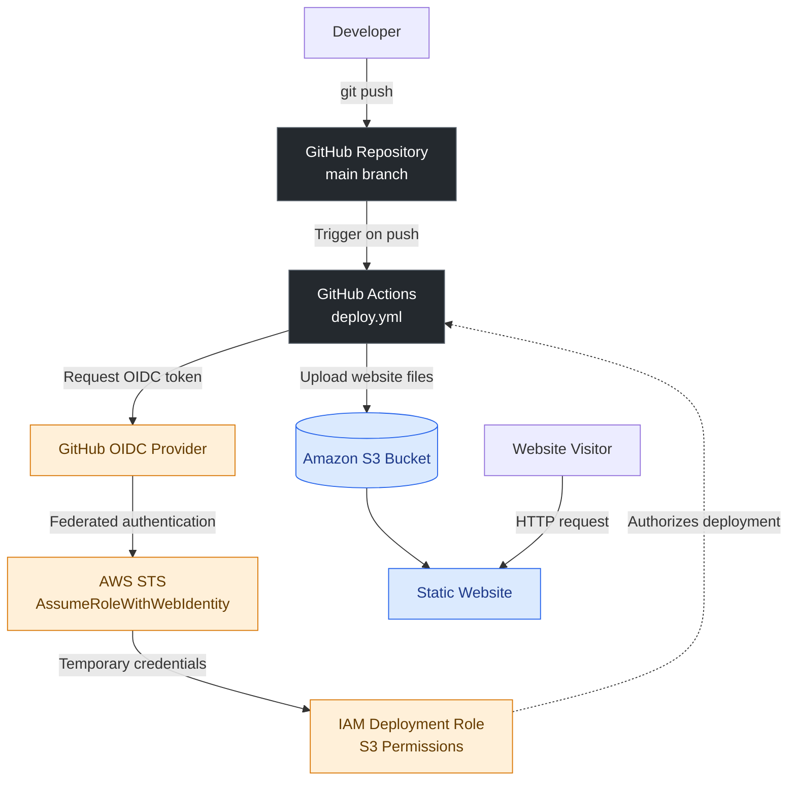

# AWS S3 Static Website Hosting with GitHub Actions

Automated static website deployment to Amazon S3 using GitHub Actions and AWS IAM OpenID Connect (OIDC).

## Architecture



## AWS Resources

| Resource | Configuration |
|---|---|
| Amazon S3 | `heet-cloud-website-2026` |
| AWS Region | `ap-south-1` (Mumbai) |
| IAM Role | `GitHubActionsS3DeployRole` |
| IAM Policy | `S3WebsiteDeploymentPolicy` |
| Authentication | GitHub Actions OIDC |
| Deployment Trigger | Push to `main` |

## CI/CD Workflow

1. Update the website files locally.
2. Commit and push changes to GitHub.
3. GitHub Actions triggers the deployment workflow.
4. GitHub OIDC authenticates with AWS through STS.
5. The IAM role provides temporary credentials with the required S3 permissions.
6. GitHub Actions uploads the updated files to the S3 bucket.
7. Verify the workflow succeeds and visit the website.

## Project Structure

```text
AWS-S3-Static-Website-Hosting/
├── .github/
│   └── workflows/
│       └── deploy.yml
├── index.html
├── style.css
└── README.md
```

## Security

- Uses OIDC federation instead of long-lived AWS access keys.
- Restricts role assumption to the specified GitHub repository and `main` branch.
- Uses an IAM policy to control S3 deployment permissions.
- The S3 website is publicly accessible for this learning project.

## Live Website

[View Website](http://heet-cloud-website-2026.s3-website.ap-south-1.amazonaws.com)

## Technologies

Amazon S3 · AWS IAM · AWS STS · GitHub Actions · OIDC · Git · HTML · CSS

## Author

[heetnandu01](https://github.com/heetnandu01)
