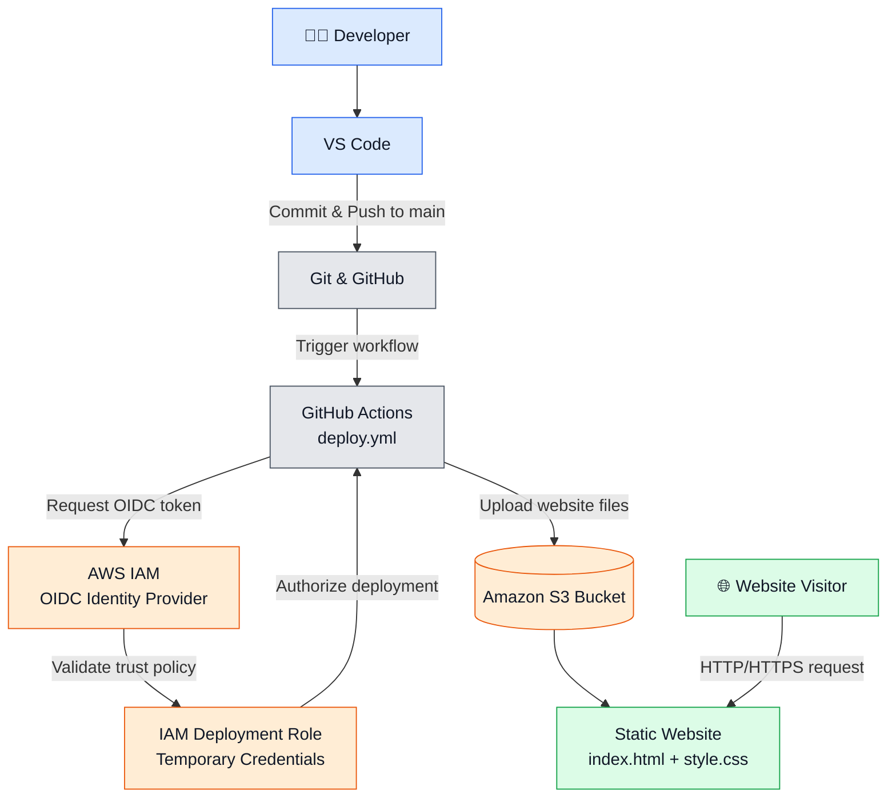

# 🚀 AWS S3 Static Website Hosting with GitHub Actions

A static website hosted on **Amazon S3**, with an automated CI/CD pipeline using **GitHub Actions** and secure AWS authentication through **IAM OpenID Connect (OIDC)**.

Every push to the `main` branch triggers the workflow, which authenticates with AWS and deploys the latest website files to the S3 bucket.

## 🌐 Live Demo

- **Website:** [View Live Website](https://heet-cloud-website-2026.s3.ap-south-1.amazonaws.com/index.html)
- **GitHub Repository:** [AWS-S3-Static-Website-Hosting](https://github.com/heetnandu01/AWS-S3-Static-Website-Hosting)

## 🏗️ Architecture Diagram



## ✨ Features

- **Static Website Hosting:** Hosts HTML and CSS files on Amazon S3 without managing a web server.
- **Automated CI/CD:** Deploys website changes automatically when code is pushed to the `main` branch.
- **Secure AWS Authentication:** Uses GitHub Actions OIDC to assume an IAM role instead of storing long-lived AWS access keys.
- **IAM Permissions:** Grants the deployment role the permissions required to upload website files.
- **Version Control:** Tracks website changes and deployment-triggering commits through Git and GitHub.
- **Cloud-Based Hosting:** Makes the website accessible through an S3 URL.

## 🛠️ Technologies Used

| Technology | Purpose |
|---|---|
| Amazon S3 | Website hosting and file storage |
| AWS IAM | Role-based access and permissions |
| GitHub Actions | CI/CD automation |
| OpenID Connect (OIDC) | GitHub-to-AWS authentication |
| Git & GitHub | Version control and source code management |
| HTML5 | Website structure |
| CSS3 | Website styling |
| Visual Studio Code | Development environment |

## 📂 Project Structure

```text
AWS-S3-Static-Website-Hosting/
│
├── .github/
│   └── workflows/
│       └── deploy.yml
│
├── index.html
├── style.css
└── README.md
```

## ⚙️ How the CI/CD Pipeline Works

1. **Develop:** Edit `index.html` or `style.css` in Visual Studio Code.
2. **Commit:** Save the changes and create a Git commit.
3. **Push:** Push the commit to the GitHub `main` branch.
4. **Trigger:** GitHub Actions automatically starts the deployment workflow.
5. **Authenticate:** GitHub Actions uses OIDC to request temporary AWS credentials by assuming the configured IAM role.
6. **Deploy:** The workflow uploads the updated website files to the S3 bucket.
7. **Verify:** Check that the GitHub Actions run succeeds, then refresh the live website.

### Example Git Commands

```bash
git add .
git commit -m "Update website"
git pull --rebase origin main
git push origin main
```

If Git reports a conflict during the pull, resolve it before pushing.

## ☁️ AWS Configuration

The project uses the following AWS resources and settings:

- **S3 Bucket:** `heet-cloud-website-2026`
- **AWS Region:** Asia Pacific (Mumbai) — `ap-south-1`
- **IAM Role:** `GitHubActionsS3DeployRole`
- **GitHub Repository:** `heetnandu01/AWS-S3-Static-Website-Hosting`
- **GitHub Actions Secret:** `AWS_ROLE_ARN`
- **Workflow File:** `.github/workflows/deploy.yml`

The IAM trust policy restricts role assumption to the specified GitHub repository and `main` branch. The deployment role has an attached inline policy for the required S3 deployment permissions.

## 🔐 Security Considerations

- Uses OIDC federation instead of storing long-lived AWS access keys in GitHub.
- Restricts the trusted GitHub repository and branch through the IAM trust policy.
- Grants the deployment role only the S3 permissions needed for the deployment.
- Public website access is intentional for this learning project. Never upload private information or credentials to a public bucket.
- For production deployments, consider Amazon CloudFront with HTTPS and a private S3 origin.

## 📚 Key Learnings

Through this project, I gained hands-on experience with:

- Configuring Amazon S3 for static website hosting.
- Managing AWS IAM roles, trust policies, and permissions.
- Integrating GitHub Actions with AWS using OIDC.
- Building an automated CI/CD deployment workflow.
- Using Git for version control and resolving push conflicts.
- Troubleshooting AWS authentication and deployment failures.
- Understanding the workflow from a local code change to a cloud deployment.

## 🚀 Future Improvements

- Add Amazon CloudFront for content delivery and HTTPS.
- Configure a custom domain using Amazon Route 53.
- Add automated HTML validation and deployment checks.
- Improve deployment observability and failure notifications.

---

**Author:** [heetnandu01](https://github.com/heetnandu01)

*Built as a hands-on AWS Cloud and DevOps learning project.*
